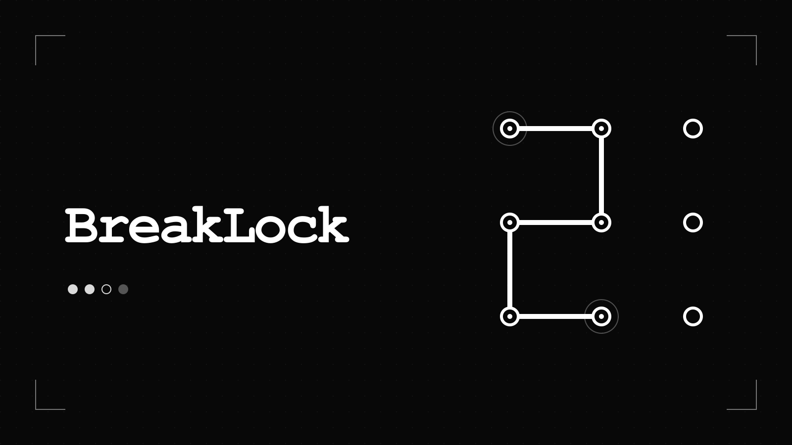

# BreakLock · AIWANNA 社区移植

基于 [maxwellito 的 BreakLock](https://github.com/maxwellito/breaklock) 制作的网页社区移植，保留原作玩法和原作者署名。原作基准提交为 [`8dedd3baccc051928b09605db5cb8dae3702d2f3`](https://github.com/maxwellito/breaklock/tree/8dedd3baccc051928b09605db5cb8dae3702d2f3)，完整 Git 历史保留。

本项目不是原作官方版本。移植工作包括现代构建、根路径托管、语言选择、翻译修订、输入与会话生命周期修复，以及 AIWANNA 平台功能适配。原版 README 的逐字副本位于 [docs/upstream-README.md](docs/upstream-README.md)。



## 怎么玩

在九宫格中连线猜出隐藏图案。每次尝试后，白点表示选中了正确的点且顺序正确，空心点表示选中了正确的点但顺序不对。简单、中等、困难分别需要连接 4、5、6 个点。

保留原作三种模式：

- **练习**：不限尝试次数。
- **挑战**：最多 10 次尝试。
- **倒计时**：60 秒内解锁，不限尝试次数。

## 本地运行与构建

使用现代 Node.js（依赖最低要求为 20.19；本轮实际使用 Node.js 26）。依赖来自 npm registry；项目不需要运行依赖安装脚本。

```sh
npm ci --ignore-scripts
npm test
npm run test:build
npm run build
python3 -m http.server 8080 --directory dist
```

然后打开 `http://localhost:8080/`。构建输出为 `dist/`，适合静态托管，无游戏服务器要求。构建使用 Dart Sass，已移除停止维护的 node-sass。原 SCSS 仍有 `@import` 与旧除法写法的弃用提示，当前版本可以完成构建。

`npm test` 执行玩法与输入等 `tests/*.test.cjs` 测试；`npm run test:build` 单独验证语言路由、翻译字符串安全及字典导出。构建及测试通过不等于完整浏览器流程或正式发布已经完成。

## 语言

当前构建 11 种语言：简体中文、英语、日语、韩语、西班牙语、繁体中文、波斯语、法语、俄语、巴西葡萄牙语和意大利语。

根页面以简体中文为原始语言。`?lang=` 优先于当前语言目录，例如 `/?lang=ja`；未知语言回退英文。显式语言目录仍可直接访问，例如 `/fr/`，菜单切换保留其他查询参数和锚点。此版本新增日语、韩语、西班牙语并修订简体中文；其余语言保留上游翻译，未声称全部重新人工校对。

源字典在 `src/l10n/*.yml`。构建另输出 `dist/i18n/{locale}.json` 纯玩家文本字典，去掉语言代码、内嵌 CSS、动画字符集合及署名 HTML，以供平台文本同步使用。

当 `src/platform/config.js` 配置真实 `gameSlug` 后，启动桥会先按当前语言读取平台公开 `/i18n/<slug>/<locale>.json`，再启动游戏。查询参数语言优先；请求最长等待 3 秒，失败时使用随包本地文本。只接受已知玩家文本键的字符串，逐键检查占位符；远程文本通过文本节点及限定的描述属性更新，不作为 HTML 执行。未配置游戏标识时不会向平台请求字典。静态语言目录和本地字典仍完整保留。

## 平台集成与发布状态

AIWANNA 云存档和排行榜适配代码已完成。存在本地适配代码，不表示已在正式平台启用；真实游戏标识、平台配置及浏览器端保存/恢复和成绩提交仍须在发布时验证。未配置时，游戏应保持本地可玩，不能将未完成的云端操作显示为成功。

本 README 编写时尚未完成正式发布，未提供虚构的游戏页面或上线状态。静态发布应上传 `dist/`，并保留其中全部许可证文件。本地浏览器已验证键盘连点、实际解锁、挑战失败与揭晓、刷新恢复和桌面/手机布局。正式发布后仍须验证平台页面、触屏/鼠标完整连线以及云存档和排行榜接口。

当前作者选择不发布社区首发宣传帖；技术部署完成不能自动触发社区发帖。

完整测试与尚未验证项见 [验收记录](docs/verification.md)，下一步见 [继续发布](docs/CONTINUE.md)。

## 版权与来源

- 原作代码：© 2017 maxwellito，[MIT 许可证](LICENSE)。保留原版权及许可文本。
- 随包 Roboto Mono Light 字体：© 2015 Google Inc.，[Apache-2.0](licenses/Apache-2.0.txt)。字体未修改，具体文件与内嵌版权证据见 [字体说明](licenses/RobotoMono-NOTICE.txt)。
- Lucide 语言图标：© 2020 Lucide Contributors，[ISC 许可证](licenses/Lucide-ISC.txt)。

[NOTICE](NOTICE) 随发布物分发；[素材来源记录](docs/asset-provenance.md) 区分已验证授权和仍有限制的来源信息。原作其他图标和图片依赖仓库整体 MIT 声明，原库没有为每个资源提供独立作者台账。名称和品牌标识不代表商标授权或任何第三方背书。
